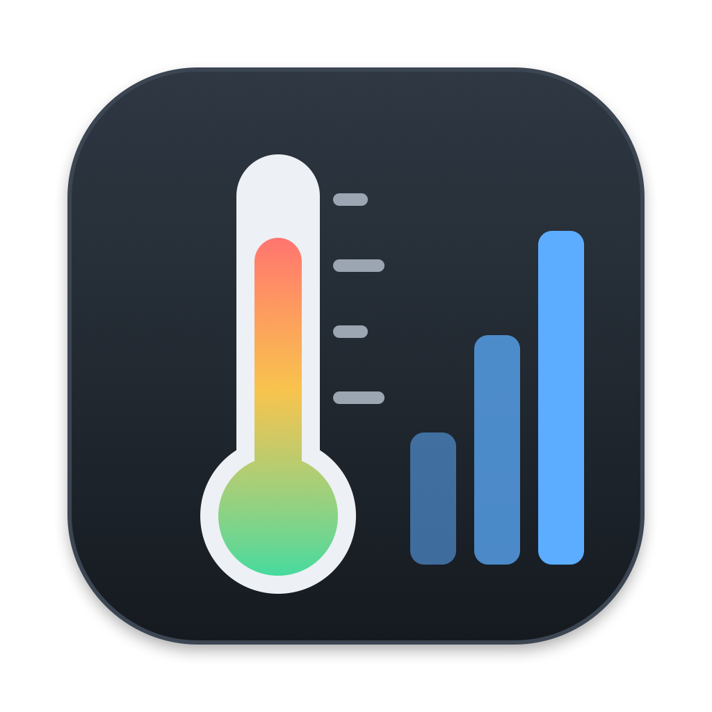

<p align="center"></p>

# Temp Monitor (macOS)

A native Mac app that shows live temperature and usage for the CPU, GPU(s), RAM and every drive, refreshed every second. It's the macOS version of the Windows Temp Monitor, built on the same idea: one card per component, a 2-minute history graph, min/max, and an honest "N/A" with the reason when the hardware has no sensor.

**No admin rights, drivers or installs needed.** Everything is read directly from the hardware through IOKit.

## Install

Download from the [latest release](https://github.com/venkateshguggilla/temp-monitor-mac/releases/latest). It works on **Apple Silicon (M1, M2, M3, M4…) and Intel Macs running macOS 14 (Sonoma) or later**. It's one universal app that runs natively on both, with no Rosetta needed.

| File | How to install |
|---|---|
| **TempMonitor-x.y.dmg** (recommended) | Open it and drag **Temp Monitor** onto **Applications**. |
| **TempMonitor-x.y.pkg** | Double-click it and follow the installer. It puts the app in `/Applications` and asks for your password. |
| TempMonitor-mac.zip | Unzip it and move **Temp Monitor.app** anywhere, for example a USB stick. |

**First launch:** the app isn't notarized by Apple, so macOS blocks it the first time ("Apple could not verify…"). Click **Done**, then go to **System Settings → Privacy & Security**, scroll down and click **Open Anyway**. The `.pkg` needs the same step before it will run. You only do this once per Mac.

To uninstall, quit Temp Monitor from its menu bar icon and move **Temp Monitor.app** from Applications to the Trash.

**Apple Silicon note:** M-series temperatures come from the chip's own sensors (HID, with an SMC fallback for newer chips). RAM has no separate sensor on these Macs, so it shows N/A. This path has only been tested on an Intel Mac so far, so please open an issue if a reading looks wrong. **Save diagnostics** writes a report you can attach.

## What it shows

| Card | Temperature source | Usage |
|---|---|---|
| CPU | SMC: package (PECI), per-core range, fan speeds. Apple Silicon: SoC die sensors | All cores, like Activity Monitor |
| GPU | SMC GPU die (discrete Radeon); integrated GPU via PECI. Apple Silicon: GPU die sensors | Driver's "Device Utilization", VRAM used |
| RAM | SMC memory-proximity sensor (Intel); none exists on Apple Silicon | "Memory Used" = app + wired + compressed; memory pressure |
| SSD / drives | The drive's own NVMe SMART sensor | Active time, read/write speed, space used, wear |

### Using the app

- **Sidebar:** Overview, CPU, Graphics, Memory, Storage and All Sensors (⌘1–⌘6).
- **Overview:** a health summary plus a panel per component. Click a panel, or press Return when it has keyboard focus, to open its page with full history charts (1, 2 or 5 minutes).
- **All Sensors:** every raw sensor in a sortable, searchable table. Select rows and press ⌘C to copy them.
- **Search** (toolbar) filters components or sensors.
- **Settings** (⌘,): theme (System / Light / Dark), units, open at login, keep on top, and which reading the menu bar shows.
- **Shortcuts:** ⇧⌘U switches °C/°F, ⌥⌘T keeps the window on top, ⌘S saves diagnostics, ⇧⌘C copies a summary, ⇧⌘R resets statistics (asks first).
- Right-click a panel or sidebar item for Copy / Show Details. Panels can also be dragged into other apps as text.

The design system is documented in [docs/DESIGN.md](docs/DESIGN.md), and the contrast checks in [docs/CONTRAST.md](docs/CONTRAST.md).

### Details

- Drives are detected automatically when you plug them in and removed when you unplug them.
- USB drives show usage, but their temperature is N/A. macOS doesn't pass SMART data through USB enclosures without a third-party driver.
- The menu bar shows the CPU temperature. Click it for a summary of every card.
- Closing the window keeps the app running in the menu bar. Quit it from the menu bar or with ⌘Q.
- **Start at login**: the app starts with just the menu-bar readout and no window.
- **All sensors** lists every raw SMC/HID sensor and fan, for comparison with other tools.
- **Save diagnostics** writes `~/Desktop/TempMonitor-diagnostics.txt`.

## Build from source

Requires Xcode 16 or later. Built with Xcode 26, the sidebar and toolbar pick up macOS 26's Liquid Glass automatically.

```bash
./build.sh
```

This produces `dist/Temp Monitor.app` (universal, ad-hoc signed), plus `TempMonitor-<version>.dmg`, `TempMonitor-<version>.pkg` and `TempMonitor-mac.zip` in `dist/`. The version comes from `Resources/Info.plist`.

- `swift build && .build/debug/TempMonitor --dump` prints every reading in the terminal.
- `.build/debug/TempMonitor --contrast-report` re-checks every colour pairing against WCAG 2.2. It exits non-zero if any check fails.
- `swift tools/make_icon.swift . && iconutil -c icns build/AppIcon.iconset -o Resources/AppIcon.icns` regenerates the icon.

Layout:
- `Sources/CSensors`: C over IOKit (SMC, NVMe SMART, HID sensors).
- `Sources/TempMonitor/DesignSystem`: colour tokens, type scale, spacing and the contrast checker.
- `Sources/TempMonitor/Components`: reusable UI pieces (status badge, meter, sparkline, panel style, toast).
- `Sources/TempMonitor/Views` and `App`: screens, scenes, menus and commands.
- `Sources/TempMonitor/*.swift`: the sensor service.
